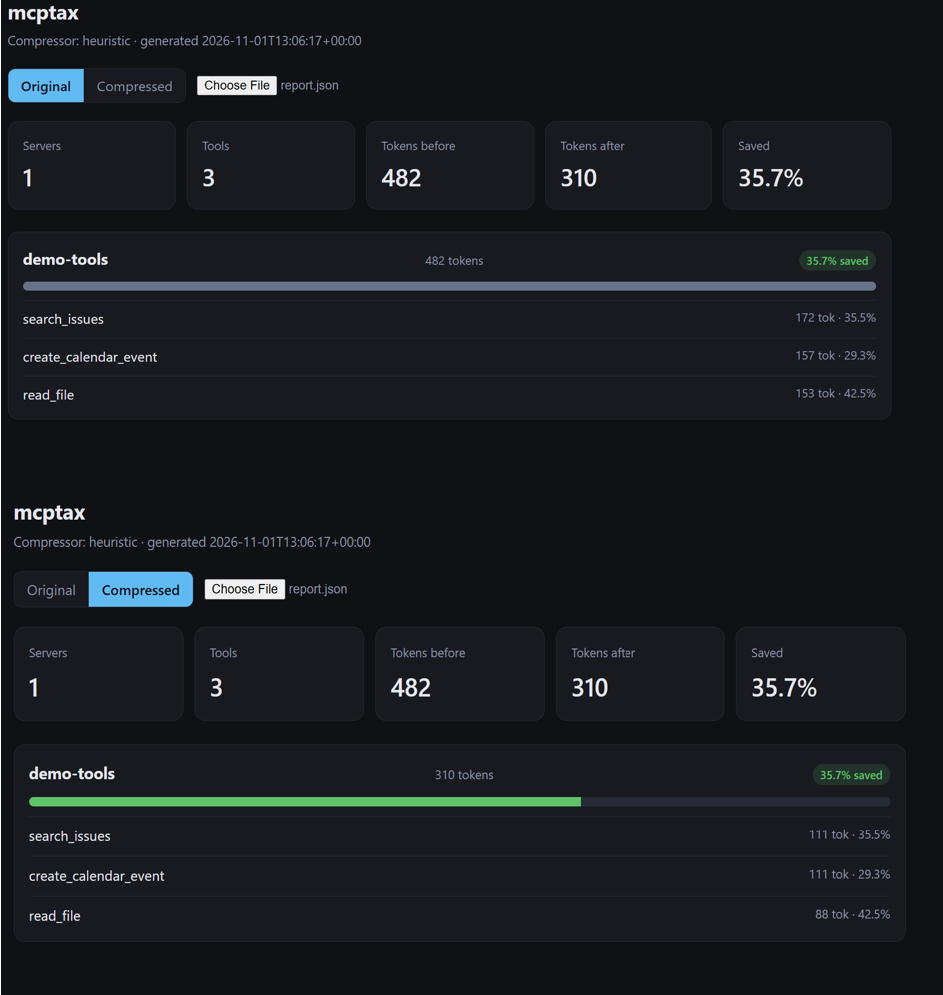

# mcptax

**Measure and shrink the token cost of your MCP servers.**

Every MCP server you connect sends its full tool list, including names, descriptions, and JSON schemas, with every model request. That overhead is invisible in most clients and grows with each server you add. `mcptax` makes the cost visible and rewrites verbose tool descriptions into shorter ones without changing what the model is allowed to call.

## Features

- **Measure:** connects to each MCP server over stdio, lists its tools, and reports the approximate token cost of each tool definition.
- **Compress:** uses an LLM on Groq (`openai/gpt-oss-120b` by default) to rewrite descriptions. An offline heuristic mode is also available.
- **Safe by construction:** the model can only change description text. Parameter names, types, and `required` fields are copied from the original and verified after every rewrite. Rewrites that do not save tokens are discarded.
- **Report and dashboard:** writes a JSON report and renders it as a static HTML dashboard with an original/compressed toggle and per-tool description diffs.
- **Zero infrastructure:** one Python package, one SQLite file, one HTML file.

## How it works

```
mcp.config.json ──► scan ──► SQLite (servers, tools, token counts)
                              │
                              ▼
                          rewrite ──► Groq LLM (descriptions only)
                              │          └─ validated against the original schema
                              ▼
                           report ──► report.json ──► dashboard/index.html
```

1. **scan** starts each server in your config, performs the MCP `initialize` handshake, calls `tools/list`, and stores each tool's token cost.
2. **rewrite** sends each tool's description and parameter descriptions to the compressor, merges the result into a copy of the schema, and verifies the structure. If the rewrite is not smaller, the original is kept.
3. **report** aggregates per-tool and per-server totals into `report.json`.

## Demo 

> 📸 

## Quick start

Requirements: Python 3.10+. Node is only needed if your own config launches `npx` servers.

```bash
cd mcptax
python3 -m venv .venv && source .venv/bin/activate   # Windows: .venv\Scripts\activate
pip install -e ".[tokens,dev]"

# 1. Offline demo (no API key needed)
mcptax run --config examples/mcp.config.json --compressor heuristic --out dashboard/report.json

# 2. Groq rewrites
cp .env.example .env          # then set GROQ_API_KEY in .env
mcptax run --config examples/mcp.config.json --compressor groq --force --delay 1 --out dashboard/report.json

# 3. Open the dashboard
python3 -m http.server 8000 -d dashboard      # then visit http://localhost:8000
```

Get a free Groq key at https://console.groq.com/keys. If you have shared a key in a chat or commit, rotate it.

## Configuration

`mcptax` reads the `mcpServers` format used by Claude Desktop and Claude Code:

```json
{
  "mcpServers": {
    "github": {
      "command": "npx",
      "args": ["-y", "@modelcontextprotocol/server-github"],
      "env": { "GITHUB_PERSONAL_ACCESS_TOKEN": "..." }
    }
  }
}
```

Entries with `"disabled": true` and remote URL-based servers are skipped in v0.1.

Environment variables (see `.env.example`):

| Variable | Default | Purpose |
|---|---|---|
| `GROQ_API_KEY` | none | Required for the `groq` compressor |
| `GROQ_MODEL` | `openai/gpt-oss-120b` | Any Groq chat model |
| `GROQ_REASONING_EFFORT` | `low` | Passed through for gpt-oss models; leave empty to omit |
| `COMPRESSOR` | `heuristic` | Default for `--compressor` |

## Commands

```bash
mcptax scan     --config mcp.config.json [--timeout 20] [--db mcptax.db]
mcptax rewrite  [--compressor groq|heuristic] [--force] [--limit N] [--delay 0.5]
mcptax report   [--out report.json]
mcptax run      --config mcp.config.json [--compressor ...] [--out report.json]
```

- Re-running `scan` replaces a server's tool list and clears its compressed versions.
- `--force` recompresses tools that were already processed.
- `--delay` helps stay under free-tier rate limits.
- Exit codes: `0` success, `1` configuration or connection error, `2` some rewrites failed.

## Example output

*Illustrative. Your numbers will vary with your servers and model.*

```
== rewrite ==
  ok [1/3] demo-tools/create_calendar_event: 118 -> 61 tokens
  ok [2/3] demo-tools/read_file: 142 -> 74 tokens
  ok [3/3] demo-tools/search_issues: 171 -> 88 tokens

Servers: 1   Tools: 3
Tokens per request: 431 -> 223 (48.3% saved)
```

## Dashboard

`dashboard/index.html` is a single file with no build step. Served over HTTP, it auto-loads `report.json`. You can also pick a report file from disk. It shows totals, a bar chart per server, and expandable per-tool details with original and compressed descriptions side by side.

## Project layout

```
mcptax/
  cli.py          command-line entry point
  config.py       MCP config and .env loading
  mcp_client.py   minimal stdio MCP client (JSON-RPC 2.0)
  tokens.py       token counting (tiktoken, with a fallback estimate)
  db.py           SQLite schema and queries
  compressor.py   heuristic and Groq compressors, validation
  pipeline.py     scan, rewrite, and report stages
dashboard/        static HTML dashboard
examples/         demo MCP server and config
tests/            unit and integration tests
```

## Development

```bash
pytest -q
```

The tests cover parameter preservation, rejection of structurally invalid rewrites, JSON parsing and retries, the Groq request format (using a mocked transport, so no network or key is needed), and a live stdio round trip against the demo server.

## Safety and privacy

- **Tool metadata leaves your machine when you use `groq`.** Descriptions and parameter descriptions are sent to Groq's API. Use `--compressor heuristic` for servers whose tool definitions contain secrets or proprietary text.
- **Secrets stay local.** API keys are read from environment variables or `.env`, which is git-ignored. `mcptax` never writes them to the database or the report.
- **Tool behavior is unchanged in structure, but not in wording.** Shorter descriptions can change how reliably a model selects a tool, so review rewrites for servers you depend on.

## Limitations (v0.1)

- Token counts are estimates for the tool definition alone, not the full request. The `cl100k_base` encoding only approximates other model families.
- Stdio servers only. Remote SSE and HTTP servers are not supported yet.
- `rewrite` stores results in SQLite and the report. It does not patch your live client config. Copy the compressed descriptions into a local proxy or fork of the server.
- Tool selection quality is not measured yet.

## Roadmap

- `mcptax export`: write compressed tool definitions as drop-in JSON.
- `mcptax eval`: measure tool-selection accuracy before and after compression.
- Usage import from session logs, so unused tools can be flagged for removal.
- Streamable HTTP transport.

## License

MIT
